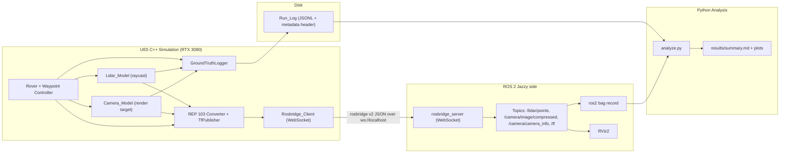

# Design Document

## Overview

Sensor Sim Sandbox is an Unreal Engine 5 (UE5) C++ project in which a drivable rover carries a raycast lidar and a camera through a small outdoor level. Each sensor captures noise-free Ground_Truth from the engine, then passes it through a shared, seeded model pipeline (Gaussian/pixel noise -> probabilistic dropout -> latency queue) to produce the Published_Value. Published values are converted from Unreal's left-handed centimeter frame to the ROS REP 103 right-handed meter frame, framed as standard `sensor_msgs` messages plus TF, and sent over a **rosbridge-style WebSocket** transport (not native DDS) to a `rosbridge_server` running under ROS 2 Jazzy. On the ROS 2 side the topics are viewable in RViz2 and recorded with `ros2 bag`. A Python tool, `analyze.py`, reads the on-disk Run_Logs and the bag recordings, computes each sensor's error against Ground_Truth (bias, standard deviation, RMSE), its measured dropout/latency against the Configured_Values, and its achieved publish rate, then writes plots and `results/summary.md` that the README consumes. Every reported number comes from a repository script recorded with its command, seed, and commit hash, in keeping with the portfolio rules.

**Requirements coverage:** Overview ties together Requirements 2–10 at a high level; detailed mappings appear per section below.

---

## Platform decision (M0)

ROS 2 Jazzy Jalisco is a Tier 1 platform on **Ubuntu 24.04 (Noble) amd64** and **Windows 10 (VS2019) amd64**, requires at minimum **C++17**, and ships `rmw_fastrtps_cpp` as its default RMW. Native DDS discovery between a Windows host and a WSL2 guest is unreliable (NAT'd virtual network, multicast quirks), so this project deliberately avoids native DDS and uses a rosbridge-style WebSocket transport over `localhost`/TCP for every option. This satisfies Requirement 1.6 and 6.4 by construction.

The M0 Smoke_Test attempts these options **in order** and keeps the first that passes (Requirement 1.1):

| Option | UE5 location | ROS 2 Jazzy location | Transport |
| --- | --- | --- | --- |
| (a) | Windows | Ubuntu 24.04 **inside WSL2** | `rosbridge_suite` WebSocket inside WSL, reached from Unreal at `localhost` |
| (b) | Windows | Windows (Jazzy binary archive) | rosbridge WebSocket on Windows `localhost` |
| (c) | Ubuntu 24.04 | Ubuntu 24.04 (NVIDIA driver ≥ 570) | rosbridge WebSocket on `localhost` |

**Pass criteria (Requirement 1.2)** — a single option passes only when all hold:
- `nvidia-smi` output is saved in `docs/ENVIRONMENT.md`; on Windows, the information `winver` displays (edition, version, OS build) is also saved there. `winver` only opens a dialog and prints nothing, so the text is captured with `cmd /c ver`, `Get-CimInstance Win32_OperatingSystem | Select-Object Caption, Version, BuildNumber`, and the `DisplayVersion` and `UBR` values under `HKLM:\SOFTWARE\Microsoft\Windows NT\CurrentVersion`.
- The Unreal editor opens to its main window with no error dialog. Evidence: the editor target is built first (so no "rebuild modules" prompt can appear), the `UnrealEditor` process shows a main window whose title contains the project name within the startup timeout, a screenshot is saved to `docs/evidence/editor_open.png`, and the editor log from startup has no `Error:` lines.
- A C++ project compiles with zero compiler errors.
- A test message sent from Unreal is observed on a ROS 2 topic via `ros2 topic echo` within 10 seconds.

**Rationale:** Option (a) is first because it keeps UE5 on the GPU-native Windows stack (RTX 3080) while giving ROS 2 its Tier-1 Ubuntu 24.04 environment, and the rosbridge WebSocket sidesteps the Windows↔WSL DDS limitation. Option (b) is the all-Windows fallback (Jazzy is Tier 1 on Windows 10/VS2019). Option (c) is last because Epic documents Ubuntu **22.04**, not 24.04, so UE5 on Noble is unproven and any problems must be recorded (Requirement 1.4).

> **M0 outcome (recorded from the Smoke_Test run on the target machine — Requirement 1.3):**
>
> - **Chosen platform option: (a)** — Unreal Engine 5.8.3 on Windows 11 with ROS 2 Jazzy inside WSL (distro `Ubuntu`, 24.04.5 LTS), and a `rosbridge_server` WebSocket inside WSL reached from Unreal at `ws://127.0.0.1:9090`. Option (a) is the first option in the ordered list (Requirement 1.1) and it passed, so no later option was attempted.
> - **Rationale:** every one of the five Requirement 1.2 pass conditions held on the first option — `nvidia-smi` and the Windows-version text captured, the editor opened to its main window with no error dialog, the C++ project compiled with zero errors, the `/smoke_test` message was observed on a ROS 2 topic within the timeout, and no step depended on Windows↔WSL DDS. Keeping UE on the GPU-native Windows stack while ROS 2 runs on its Tier-1 Ubuntu over a localhost WebSocket matched the design intent, so (b) and (c) were unnecessary.
> - **Provenance (Requirement 0.1):** generating command `powershell -NoProfile -ExecutionPolicy Bypass -File scripts\smoke_test.ps1 -EnginePath "C:\Program Files (x86)\UE_5.8" -WsUrl "ws://127.0.0.1:9090" -WslDistro "Ubuntu"`; commit `101d32bf25db9bf86fd06b5a4aa35c20855d982c`. The smoke test is deterministic (no seed parameter); the same command on the same commit reproduces the result.
> - **Evidence artifacts (all on disk):**
>   - `results/smoke_result.json` — records `chosen_option: "a"`, every condition `true`, and the command and commit above.
>   - `docs/evidence/compile.log` — C++ project build (`Result: Succeeded`).
>   - `docs/evidence/editor_open.png` — editor main window, no error dialog.
>   - `docs/evidence/editor_startup.log` — editor startup with no `Error:` lines.
>   - `docs/evidence/ros2_echo_smoke.txt` — `ros2 topic echo` showing `data: sensor-sim-sandbox` on `/smoke_test`.
>   - `docs/ENVIRONMENT.md` "Platform smoke-test evidence (M0)" block — the live `nvidia-smi` and Windows-version (`winver`-equivalent) captures and proven tool versions.
> - **If all three options had failed:** per-option first-failing conditions would be recorded in `docs/ENVIRONMENT.md` (Requirement 1.5). Not applicable here — option (a) passed; option (c) is noted there as "not attemptable on this host" (no native Ubuntu 24.04).
>
> **Two environment specifics later milestones depend on:**
>
> - **Non-default engine path.** Unreal Engine 5.8.3 is installed at `C:\Program Files (x86)\UE_5.8`, **not** the Epic default `C:\Program Files\Epic Games\UE_5.8`. Every script that invokes `Build.bat`, `UnrealEditor.exe`, or `UnrealEditor-Cmd.exe` must take the engine path as a parameter (as `smoke_test.ps1 -EnginePath` does) rather than hard-coding the default.
> - **rosbridge root-path quirk (relevant to M2 bridge work).** The `rosbridge_server` must be launched with `url_path:=//` (double slash). UE's bundled libwebsockets client requests `GET //` for a root `ws://` URL, so a server listening on the default single-slash root path rejects the handshake; launching with `url_path:=//` makes the double-slash request match. The M2 Rosbridge_Client and any end-to-end run that starts rosbridge must apply this.

Options (b) and (c) are attempted only if every earlier option fails. Option (c) needs a native Ubuntu 24.04 install, which this Windows desktop does not have; if it is ever reached, its first-failing condition is recorded as "not attemptable on this host".

**Requirements coverage:** Requirement 1 (1.1–1.6), 6.4.

---

## Execution environment (where the tasks run)

Kiro runs every task on the owner's Windows 11 desktop with the RTX 3080. That desktop is also the GPU and Unreal host, so steps that need the editor, the GPU, or a running simulation run here for real; nothing is deferred to another machine. The only owner-only item is an optional visual look at the point cloud in RViz2.

| Item | Value |
| --- | --- |
| Repository root | `C:\dev\Sensor-Sim-Sandbox` (WSL path `/mnt/c/dev/Sensor-Sim-Sandbox`) |
| Unreal Engine | 5.8.x from the Epic Games Launcher at `C:\Program Files\Epic Games\UE_5.8` |
| Unreal project | `unreal/SensorSimSandbox/SensorSimSandbox.uproject`, module `SensorSimSandbox`, editor target `SensorSimSandboxEditor`, level `/Game/Maps/RoverLevel` |
| Visual Studio | 2026 with the workloads Epic lists for UE 5.8 |
| ROS 2 | Jazzy in WSL distro `Ubuntu-24.04`, sourced with `source /opt/ros/jazzy/setup.bash` |
| rosbridge | `ros2 launch rosbridge_server rosbridge_websocket_launch.xml`, reached from Windows at `ws://localhost:9090` |
| Python | Windows `py -3.12`, virtual environment `.venv` at the repository root, pinned packages in `analysis/requirements.txt` |
| Other tools | Git, GitHub CLI (`gh`, already signed in), FFmpeg (`ffmpeg` on PATH) |

**Rules that keep an unattended run safe and repeatable**
- **Unreal tools only through scripts.** Every Unreal build, test, or launch is a PowerShell script in `scripts/`, run as `powershell -NoProfile -ExecutionPolicy Bypass -File scripts\<name>.ps1`.
- **One Unreal process at a time.** Before building or launching, a script waits until no `UnrealBuildTool` or `UnrealEditor*` process is running, and it passes `-WaitMutex` to `Build.bat`. Tasks that run in the same wave must not build the same project concurrently.
- **Long steps run in the background.** Kiro stops a single command after at most 30 minutes. A cold build, the first editor launch (shader compile), and the end-to-end run start as background processes that write to `runs/logs/<name>.log` and an exit-code file; the agent polls those files with short commands.
- **ROS commands run inside WSL from Windows:** `wsl -d Ubuntu-24.04 -- bash -c "source /opt/ros/jazzy/setup.bash && <command>"`. No ROS 2 node runs on the Windows side, so no DDS traffic crosses Windows and WSL.
- **No `sudo`.** System packages are installed by the owner before the run. A missing system package is a blocker, not something to work around.
- **Bags** are recorded inside WSL with `ros2 bag record -s sqlite3 -o /mnt/c/dev/Sensor-Sim-Sandbox/runs/<run_id>/bag <topics>` and read on Windows with the pure-Python `rosbags` package (Apache-2.0), so the analysis never imports ROS. A minimal test proves the installed `rosbags` version reads a Jazzy sqlite3 bag before the loader relies on it.
- **Raw outputs vs results.** Run_Logs, bags, frames, and logs go under `runs/` (gitignored). Generated tables and plots go under `results/` and are committed.
- **Numbers come from committed code.** Before any run whose numbers are reported, the agent commits the source, records `git rev-parse HEAD`, and refuses to report if `git status --porcelain` shows changes outside `results/`, `runs/`, `docs/`, and `README.md`.
- **Retry cap.** A gate or verification that still fails after 3 fix attempts for the same cause is recorded in `docs/BLOCKERS.md` (task, command, exit code, log path, suspected cause) and that task stops. Targets and tests are never loosened to pass (Requirement 0.4).

**Requirements coverage:** 0.1, 0.4, 0.5, 0.6, 1.2, 1.6, 6.4, 9.2.

---

## Architecture



**Requirements coverage:** Requirements 2–8, 10 (end-to-end data path).

---

## Repository layout

The repository remote is `https://github.com/OctaviusLeo/Sensor-Sim-Sandbox.git` (private until released; no public license or packaging — portfolio rules).

```
Sensor-Sim-Sandbox/
├── unreal/
│   └── SensorSimSandbox/
│       ├── SensorSimSandbox.uproject
│       ├── Config/                      # engine/project ini, sensor config loader
│       ├── Content/Maps/RoverLevel.umap # level built from engine basic shapes only
│       └── Source/
│           ├── SensorSimSandbox.Target.cs
│           ├── SensorSimSandboxEditor.Target.cs
│           └── SensorSimSandbox/
│               ├── Rover/               # ARover pawn, WaypointController
│               ├── Sensors/             # SensorModel base, Lidar_Model, Camera_Model (M5: Imu, Gps)
│               ├── Bridge/              # Rosbridge_Client (WebSockets), plugin-eval notes
│               ├── Coords/              # REP 103 converter, TfPublisher
│               ├── GroundTruth/         # GroundTruthLogger (JSONL writer)
│               └── Tests/               # Unreal Automation tests (headless-runnable)
├── analysis/
│   ├── sensorsim_analysis/              # Python package: loaders, metrics, plots, summary
│   │   ├── __init__.py
│   │   ├── loaders.py                   # JSONL + ros2 bag readers
│   │   ├── metrics.py                   # bias/std/RMSE, dropout, latency, rate
│   │   ├── plots.py
│   │   └── summary.py                   # writes results/summary.md
│   ├── analyze.py                       # single-command entry point
│   ├── requirements.txt                 # pinned Python dependencies
│   └── tests/                           # pytest on synthetic logs with known answers
├── config/                              # seeded YAML: run seed + full sensor config
│   ├── lidar.yaml
│   ├── camera.yaml
│   ├── level.yaml                       # obstacle and landmark placement
│   └── run.yaml
├── results/                             # generated: summary.md, plots (not hand-edited)
├── runs/                                # gitignored: Run_Logs, bags, frames, logs per run
├── docs/
│   ├── ENVIRONMENT.md                   # proven versions + nvidia-smi and Windows-version evidence
│   ├── evidence/                        # smoke-test screenshot, compile log, echo capture
│   ├── media/demo.gif                   # captured from the running simulation
│   └── BLOCKERS.md                      # only created if a gate hits the retry cap
├── scripts/                             # PowerShell: smoke test, UE build/test runner, end-to-end run
├── .github/
│   └── workflows/
│       └── ci.yml                       # GitHub Actions: pytest on push/PR
├── THIRD_PARTY.md                       # third-party names, versions, licenses
└── README.md
```

`.gitignore` also lists the Unreal outputs (`Binaries/`, `Intermediate/`, `Saved/`, `DerivedDataCache/`, `*.sln`, `.vs/`), `.venv/`, `__pycache__/`, and `runs/`, so build products and raw data are never committed.

**Requirements coverage:** Requirement 0.5, 0.7, 0.8, 0.9; 8.6, 9.*, 10.1.

---

## Components and interfaces

### Rover + Waypoint Controller
- **Responsibility:** Drivable ground pawn with keyboard control and a scripted waypoint mode.
- **Key parameters:** `waypoints` (ordered list of REP 103 / Unreal positions), `arrival_tolerance_m`, `waypoint_timeout_s`.
- **Interface:** `SetMode(Manual|Waypoint)`, `Tick(dt)`; controller is isolated from the engine so its state machine (current index, arrived?, timed-out?) is unit-testable without rendering.
- **Contract:** In Waypoint mode, keyboard input is ignored; waypoints are visited in configured order; index advances when within `arrival_tolerance_m`; at the final waypoint the rover holds with zero throttle/steer; on timeout it stops and reports the unreached waypoint.
- **Level content:** `/Game/Maps/RoverLevel` holds a ground plane, a directional light and a sky light (so camera frames are not black), at least three obstacles and at least three landmarks built only from engine basic shapes (`/Engine/BasicShapes/`) and engine materials, placed from `config/level.yaml`. No marketplace content is used. The map is created without the editor UI, either by an editor Python script run headless (the exact command is proven on this engine version before use) or by spawning the actors from C++ at `BeginPlay` on a minimal saved map. The run selects waypoint mode and the run config from command-line arguments so the end-to-end run needs no keyboard.
- **Requirements:** 2.1, 2.2, 2.3, 2.4, 2.5, 2.6.

### Lidar_Model
- **Responsibility:** Raycast lidar producing a point cloud per scan.
- **Configurable parameters (with bounds — Requirement 3.1):** `channels` (1–128), `h_fov_deg` (0 exclusive–360], `v_fov_deg` (0 exclusive–180], `angular_resolution_deg` (0.01–10.0), `max_range_m` (0.1–1000.0), `rate_hz` (0.1–100.0), `range_noise_sigma_m` (0.0–10.0), `dropout_prob` (0.0–1.0), `latency_ms` (0–1000).
- **Message/frame contract:** publishes `sensor_msgs/PointCloud2` with `frame_id` = lidar sensor frame and `stamp` = scan acquisition time (Requirement 3.3, 3.4).
- **Requirements:** 3.1–3.7.

### Camera_Model
- **Responsibility:** Scene-capture camera producing compressed frames with calibration.
- **Configurable parameters (with bounds — Requirement 4.1):** `width`/`height` (1–7680), `rate_hz` (0.1–100.0), `pixel_noise_sigma` (0.0–255.0), `frame_dropout_prob` (0.0–1.0), `latency_ms` (0–1000).
- **Message/frame contract:** publishes `sensor_msgs/CompressedImage` (JPEG) with an accompanying `sensor_msgs/CameraInfo` whose `width`/`height` equal the configured resolution and whose intrinsics equal those used to render the frame (Requirement 4.3, 4.4).
- **Requirements:** 4.1–4.6.

### Shared SensorModel pipeline
All sensors share one pipeline, implemented as pure, seeded, independently-testable stages so each stage can be unit/property tested without the engine:
1. **Capture Ground_Truth** — exact engine value (ray ranges, rendered pixels).
2. **Add seeded noise** — Gaussian range noise (lidar) or additive per-pixel noise (camera) drawn from a per-sensor RNG.
3. **Apply dropout** — drop each ray / frame independently with probability `p` using the same per-sensor RNG.
4. **Enqueue with timestamp** — push `(seq, capture_time, payload)` onto a latency queue.
5. **Release after latency** — at each check, emit every sample with `capture_time + latency <= now` and stamp it with `publish_time = now`. With latency 0 a sample is released in the same tick it was captured (delay exactly 0). In the engine the check runs every game tick; in tests it runs on a synthetic clock.
- **Config validation contract:** any parameter outside its bound is rejected, the offending parameter is named in the error, and the last valid configuration is retained (Requirement 3.2, 4.2).
- **Requirements:** 0.2, 0.3, 3.2, 3.5, 3.6, 3.7, 4.2, 4.5, 4.6, 11.* (reused for IMU/GPS).

### GroundTruthLogger
- **Responsibility:** Write a Run_Log for every run.
- **Interface:** `BeginRun(seed, config)` writes a metadata header; `LogSample(sensor, seq, t_capture, t_publish, dropped, pose, truth, published)` appends one record per sensor sample (format in "Ground-truth logging format"); `EndRun()` flushes.
- **Contract:** records carry monotonically non-decreasing timestamps (seconds); format is machine-readable JSONL read by `analyze.py` without manual conversion; camera sampling interval is recorded when frames are sampled; seed and full sensor config are in the header; a write failure stops the run, retains data already written, and emits an error identifying the failure.
- **Requirements:** 5.1–5.5.

### REP 103 Converter + TfPublisher
- **Responsibility:** Convert Unreal (left-handed, cm) poses/vectors to REP 103 (right-handed, m) and publish TF.
- **Interface:** `ConvertPosition(FVector)->Vec3`, `ConvertRotation(FQuat)->Quat`, `TfPublisher.Publish(rover + each sensor frame)`.
- **Contract:** position/rotation conversions match expected values to 1e-6; TF for the rover body and each sensor frame publishes at ≥ 10 Hz.
- **Requirements:** 7.1–7.4.

### Rosbridge_Client
- **Responsibility:** Transport messages to ROS 2 over a rosbridge-style WebSocket.
- **Configurable parameters:** `host`, `port` (both changeable without recompilation — Requirement 6.3).
- **Interface:** `Advertise(topic, type)`, `Publish(topic, msg)`; binary payloads (PointCloud2 `data`, JPEG bytes) are base64-encoded inside the JSON `msg`.
- **Contract:** emits rosbridge v2 JSON ops; on connection loss, retries at intervals of no more than 5 seconds until reconnected, and the Unreal editor keeps running throughout; never relies on Windows↔WSL DDS discovery.
- **Requirements:** 6.2, 6.3, 6.4, 6.5.

### Analysis_Tool (`analyze.py`)
- **Responsibility:** Single-command analysis of Run_Logs + ROS bags.
- **Interface:** `analyze.py --run <run.yaml>` → reads logs/bags, computes metrics, writes plots + `results/summary.md`.
- **Contract:** per sensor reports bias/std/RMSE vs time-aligned Ground_Truth, measured vs configured dropout and latency, and achieved publish rate; cross-checks rate against `ros2 topic hz`; on missing/unparsable input it terminates without writing a Summary_File and emits an error; two runs on identical inputs produce bitwise-identical numeric results.
- **Requirements:** 8.1–8.8, 10.1.

---

## Sensor model math

All randomness flows from a single run seed. Each sensor derives an independent, named sub-stream so sensors do not perturb one another, and so re-running with the same seed and config reproduces every draw exactly (Requirement 0.2, 0.3).

**Lidar range (per ray i):**
```
r_published[i] = r_truth[i] + e[i],   e[i] ~ N(0, sigma^2)
```
where `sigma = range_noise_sigma_m`. Published ranges are not clamped (a noisy range may exceed `max_range_m` or fall below 0), because clamping would bias the recovered sigma. A ray with no hit within `max_range_m` has no return; it is logged as `null` and excluded from noise and dropout statistics. Over ≥ 1000 returns the sample standard deviation of `(r_published - r_truth)` recovers `sigma` within ±10% (Requirement 3.5).

**Per-ray dropout:** ray i is dropped iff `u[i] < p`, `u[i] ~ Uniform[0,1)`, `p = dropout_prob`. The dropped fraction must land within ±2 percentage points of `p` (Requirement 3.6); see "Sample sizes" below for how many rays that takes.

**Camera per-pixel noise:** `pix_published[x,y,c] = clamp(pix_truth[x,y,c] + n, 0, 255)`, `n ~ N(0, pixel_noise_sigma^2)`. **Frame dropout:** frame dropped iff `u < frame_dropout_prob`; measured fraction within ±2 pp (Requirement 4.5); see "Sample sizes" below.

**Latency queue:** a sample captured at `capture_time` with configured latency `L` is released at the first check where `capture_time + L <= now`, so the release error lies in `[0, dt)` where `dt` is the time between checks. Measured latency is the mean of `t_publish - t_capture` over released samples and must match `L` within ±20% (Requirement 3.7, 4.6). In the engine the check runs every game tick, so the end-to-end run uses `L = 200 ms` (tolerance ±40 ms) and caps the frame rate at 120 fps; the result holds whenever the game runs faster than 25 fps (`dt < 40 ms`), and the run log records the average frame time so a miss can be attributed. Property tests use a synthetic clock stepping `L/50` (error under 2%), and `L = 0` must give a delay of exactly 0.

### Sample sizes that make the ±2 pp and ±10% tolerances achievable

Requirements 3.5, 3.6 and 4.5 set minimum sample counts ("at least 1000 rays", "at least 100 frames"). At those minimums a correct implementation fails the dropout tolerance often, so a test or run sized at the minimum would fail for statistical reasons and invite an endless fix loop. Planning calculation (exact binomial for dropout, chi-square for the sample standard deviation; planning figures, not measured results):

| Case | Samples | Probability that a correct model fails one run |
| --- | --- | --- |
| Frame dropout, p = 0.10, 100 frames (spec minimum) | 100 | 0.40 |
| Frame dropout, p = 0.30, 100 frames | 100 | 0.59 |
| Ray dropout, p = 0.50, 1000 rays (spec minimum) | 1,000 | 0.19 |
| Ray dropout, p = 0.10, 1000 rays | 1,000 | 0.031 |
| Dropout with `n ≥ 40,000·p·(1−p)` (4 standard errors), p = 0.05 / 0.10 / 0.50 | 1,900 / 3,601 / 10,000 | about 6.5e-5 each |
| Dropout property test, 20,000 draws per iteration, worst case p = 0.5 | 20,000 | 1.5e-8 per iteration |
| Noise sigma ±10%, 1,000 returns | 1,000 | 7.9e-6 |
| Noise sigma ±10%, 20,000 draws per iteration | 20,000 | below 1e-80 |

Rules that follow (tolerances and requirement minimums are unchanged; only sample counts go up):
- **Dropout checks use `n ≥ ceil(40,000 · p · (1 − p))` samples**, never fewer than the requirement minimum.
- **Property tests 3 and 4 use 20,000 draws per iteration** (≥ 100 iterations), with fixed seeds. A failing seed is investigated as a bug; seeds are never changed to make a test pass.
- **The end-to-end run is sized by sample counts, not by time:** with camera `frame_dropout_prob = 0.05` it runs until at least 2,000 camera frames have been produced (dropped or not) and at least 120 s have elapsed. That is about 200 s at a 10 Hz capture rate and about 400 s at 5 Hz.

**Determinism:** a per-sensor RNG is seeded deterministically from the run seed (e.g. `sensor_seed = hash(run_seed, sensor_name)`). Identical seed + config ⇒ identical noise/dropout draws ⇒ byte-for-byte identical output excluding timestamps/paths (Requirement 0.3). IMU/GPS (M5) reuse this same math with their own noise + bias parameters (Requirement 11.1, 11.2).

**Requirements coverage:** 0.2, 0.3, 3.5, 3.6, 3.7, 4.5, 4.6, 11.1, 11.2.

---

## Bridge design

### Plugin evaluation (completed in M2, recorded here and in `design.md`)

Before writing a client, each existing Unreal-to-ROS 2 bridge plugin is scored against three criteria. The table template below is filled in during M2 (Requirement 6.1):

| Plugin | UE 5.x support | OS support (chosen platform) | WebSocket/TCP, not DDS | Source update < 12 months | Verdict |
| --- | --- | --- | --- | --- | --- |
| _candidate 1_ | _TBD_ | _TBD_ | _TBD_ | _TBD_ | _accept / reject + reason_ |
| _candidate 2_ | _TBD_ | _TBD_ | _TBD_ | _TBD_ | _accept / reject + reason_ |

If no evaluated plugin satisfies **all three** criteria, the fallback Rosbridge_Client is used (Requirement 6.2).

### Fallback Rosbridge_Client specification

Implemented in C++ with Unreal's WebSockets module. It speaks the rosbridge v2 protocol with two JSON op types:

- **Advertise:** `{"op":"advertise","topic":"<topic>","type":"<ros_type>"}` sent once per topic before publishing.
- **Publish:** `{"op":"publish","topic":"<topic>","msg":{...}}` where `msg` is the ROS message serialized as JSON. Binary fields — `sensor_msgs/PointCloud2.data` and the `sensor_msgs/CompressedImage.data` JPEG bytes — are **base64-encoded** strings inside `msg`.

**Reconnect behavior:** on disconnect the client schedules reconnection attempts no more than 5 seconds apart until the socket reopens, re-sends advertises, and resumes publishing; the editor keeps running throughout (Requirement 6.5). Host and port are read from config and changeable without recompilation (Requirement 6.3).

**Requirements coverage:** Requirement 6 (6.1–6.5).

---

## Coordinate conversion

Unreal uses a left-handed frame in centimeters; REP 103 is right-handed in meters with **x forward, y left, z up**. The position transform flips the Y axis and rescales:

```
x_ros = x_ue / 100
y_ros = -y_ue / 100
z_ros =  z_ue / 100
```

**Rotation:** the Y-axis flip is a handedness change, so a quaternion `(w, x, y, z)` in Unreal maps to REP 103 by negating the components about the flipped axis — i.e. `q_ros = (w, -x, y, -z)` (equivalently negating the X and Z rotational components to preserve the right-handed sense). The exact mapping is fixed in `Coords/` and verified against hand-worked expected values.

**Verification:** unit tests check position conversion to within **1e-6 m** (Requirement 7.2) and rotation conversion to within **1e-6 rad** (Requirement 7.3), including a round-trip (`convert` then inverse) identity check.

**Requirements coverage:** Requirement 7 (7.1, 7.2, 7.3).

---

## Ground-truth logging format

Each Run_Log is a `.jsonl` file: the first line is a metadata header, each subsequent line is one sample record.

**Metadata header (Requirement 5.4, 5.3):**
```json
{"type":"run_meta","seed":1234,"commit":"<full-sha>","sensor_config":{"lidar":{...},"camera":{...}},"camera_sampling_interval":"1/5"}
```
(`camera_sampling_interval` is the frames-logged-per-frames-produced ratio, present only when camera frames are sampled rather than logged in full.)

**Sample record (Requirement 5.1):** one line per sensor sample (a lidar scan or a camera frame), so the truth and the published value of the same capture always sit in the same record:
```json
{"type":"sample","sensor":"lidar","seq":42,"t":12.545,"t_capture":12.345,"t_publish":12.545,"dropped":false,
 "rover_pose":{"pos":[x,y,z],"quat":[w,x,y,z]},
 "truth":[...],"published":[...]}
{"type":"sample","sensor":"camera","seq":17,"t":12.550,"t_capture":12.350,"t_publish":12.550,"dropped":false,
 "rover_pose":{"pos":[x,y,z],"quat":[w,x,y,z]},
 "truth_ref":"frames/cam_000017.png","published_ref":"frames/cam_000017_pub.jpg"}
{"type":"sample","sensor":"camera","seq":18,"t":12.451,"t_capture":12.451,"t_publish":null,"dropped":true,
 "rover_pose":{"pos":[x,y,z],"quat":[w,x,y,z]}}
```
- `t` is the time the record is written (the release time for a published sample, the capture time for a dropped frame), so `t` is monotonically non-decreasing in file order. All times are seconds since run start from a monotonic clock (`FPlatformTime::Seconds()` minus the run start). ROS `header.stamp` values separately use UTC wall time at capture.
- `seq` counts captures per sensor from 0, so missing or duplicated samples are detectable.
- Lidar: `truth[i]` is the noise-free range of ray i or `null` for no hit; `published[i]` is the noisy range or `null` when the ray was dropped or had no hit. Per-ray dropout is counted over rays whose truth is not `null`.
- Camera: every produced frame gets a record, including dropped ones (`dropped: true`, no image refs), so frame dropout is measured over all frames. Image files are written only for sampled frames (`camera_sampling_interval`); other published frames carry `"truth_ref":null,"published_ref":null`.
- The format is plain JSONL so `analyze.py` loads it directly without manual conversion (Requirement 5.2).

**Write-failure handling (Requirement 5.5):** if a write fails mid-run, the logger stops the run, keeps all records already flushed to disk, and emits an error identifying the write failure.

**Requirements coverage:** Requirement 5 (5.1–5.5).

---

## Analysis tool design

`analyze.py` runs in these stages:
1. **Load** the specified Run_Logs (JSONL) and `ros2 bag` recordings (Requirement 8.1). Run_Logs are streamed line by line and each record's arrays are converted to `numpy.float64` immediately, so a multi-million-ray run fits in memory. Bags are read with `rosbags` (sqlite3 storage). Missing or unparsable input ⇒ terminate without writing a Summary_File, emitting an error naming the bad input (Requirement 8.2).
2. **Align** each published value with its Ground_Truth: both come from the same capture and sit in the same record, matched by `(sensor, seq)` and `t_capture` (lidar per ray; camera per pixel and channel, decoding the published JPEG and comparing it with the truth PNG on sampled frames).
3. **Per-sensor error metrics** over matched samples, accumulated in file order: `bias = mean(published - truth)`, `std = std(published - truth)`, `RMSE = sqrt(mean((published - truth)^2))` (Requirement 8.3).
4. **Dropout & latency:** dropout = dropped count / produced count (rays with a hit for lidar; frames for camera); latency = `1000 × mean(t_publish − t_capture)` in ms over published samples; each reported beside its Configured_Value (Requirement 8.4).
5. **Achieved rate:** for `n` published samples whose `t_publish` spans `T` seconds, `rate_hz = (n - 1) / T` over the full run (Requirement 8.5); cross-checked against the bag's message timestamps and the `ros2 topic hz` capture used for the README targets.
6. **Outputs:** matplotlib plots saved to `results/`, and `results/summary.md` generated (never hand-edited) for the README (Requirement 8.6). The whole flow is one command (Requirement 8.7).

**Determinism (Requirement 8.8):** metric computations avoid nondeterministic iteration order and fix any sampling seed, so two runs on identical inputs yield bitwise-identical numeric results in the Summary_File.

**Requirements coverage:** Requirement 8 (8.1–8.8), 10.1.

---

## Data Models

This section consolidates the key data structures already described elsewhere in the design into one typed reference. Bounds and formats match the Components, Sensor-model-math, Bridge, Logging, and Analysis sections above.

### Configuration models

**SensorConfig (shared top-level)** — one run seed plus the per-sensor parameter structs.

| Field | Type | Notes |
| --- | --- | --- |
| `seed` | int | Single run seed; every per-sensor RNG derives from it (Requirement 0.2, 0.3). |
| `lidar` | LidarConfig | Lidar parameter struct (below). |
| `camera` | CameraConfig | Camera parameter struct (below). |
| `imu` | ImuConfig (M5) | Optional; present once IMU is added. |
| `gps` | GpsConfig (M5) | Optional; present once GPS is added. |

**LidarConfig** (bounds enforced; out-of-bound values rejected — Requirement 3.1, 3.2).

| Field | Type | Bound | Notes |
| --- | --- | --- | --- |
| `channels` | int | 1–128 | Vertical channel count. |
| `h_fov_deg` | float | (0, 360] | Horizontal field of view. |
| `v_fov_deg` | float | (0, 180] | Vertical field of view. |
| `angular_resolution_deg` | float | 0.01–10.0 | Angular step between rays. |
| `max_range_m` | float | 0.1–1000.0 | Maximum ray range (meters). |
| `rate_hz` | float | 0.1–100.0 | Scan rate. |
| `range_noise_sigma_m` | float | 0.0–10.0 | Gaussian range-noise standard deviation. |
| `dropout_prob` | float | 0.0–1.0 | Per-ray drop probability. |
| `latency_ms` | int | 0–1000 | Publish latency. |

**CameraConfig** (bounds enforced — Requirement 4.1, 4.2).

| Field | Type | Bound | Notes |
| --- | --- | --- | --- |
| `width` | int | 1–7680 | Frame width (px). |
| `height` | int | 1–7680 | Frame height (px). |
| `rate_hz` | float | 0.1–100.0 | Frame rate. |
| `pixel_noise_sigma` | float | 0.0–255.0 | Additive per-pixel Gaussian noise sigma. |
| `frame_dropout_prob` | float | 0.0–1.0 | Per-frame drop probability. |
| `latency_ms` | int | 0–1000 | Publish latency. |

**RunConfig** — top-level run description loaded from `config/run.yaml`.

| Field | Type | Notes |
| --- | --- | --- |
| `seed` | int | Run seed (mirrors / supplies `SensorConfig.seed`). |
| `output_dir` | path | Where Run_Logs, bags, and `results/` artifacts are written. |
| `camera_sampling_interval` | string (ratio) | Frames-logged-per-frames-produced, e.g. `"1/5"` (Requirement 5.3). |
| `lidar_config` | ref | Path/reference to `config/lidar.yaml` → LidarConfig. |
| `camera_config` | ref | Path/reference to `config/camera.yaml` → CameraConfig. |
| `min_camera_frames` | int | End-to-end run stops only after at least this many camera frames were produced (2,000 for Gate A; see "Sample sizes"). |
| `min_duration_s` | float | And only after at least this many seconds (120 for Gate A, room for the two 60 s rate windows). |
| `max_fps` | int | Frame-rate cap for the run (120), applied with `t.MaxFPS`; vsync off. |

**Gate A run configuration** (the values `config/*.yaml` ship with; all inside the requirement bounds):

| Sensor | Values |
| --- | --- |
| Lidar | `channels` 16, `h_fov_deg` 360, `v_fov_deg` 30, `angular_resolution_deg` 1.0 (5,760 rays per scan), `max_range_m` 100, `rate_hz` 10, `range_noise_sigma_m` 0.02, `dropout_prob` 0.10, `latency_ms` 200 |
| Camera | `width` 640, `height` 480, `rate_hz` 10, `pixel_noise_sigma` 5.0, `frame_dropout_prob` 0.05, `latency_ms` 200, `camera_sampling_interval` "1/10" |
| Run | `seed` 1234, `min_camera_frames` 2000, `min_duration_s` 120, `max_fps` 120 |

**ImuConfig / GpsConfig (M5)** — reuse the shared seeded pipeline math with their own noise and bias parameters (Requirement 11.1, 11.2).

| Model | Fields | Notes |
| --- | --- | --- |
| `ImuConfig` | `rate_hz`, `accel_noise_sigma`, `accel_bias`, `gyro_noise_sigma`, `gyro_bias`, `dropout_prob`, `latency_ms` | Noise + constant bias per axis; same bound-checking contract as other sensors. |
| `GpsConfig` | `rate_hz`, `position_noise_sigma_m`, `position_bias_m`, `dropout_prob`, `latency_ms` | Noise + bias in meters; same bound-checking contract. |

### Run_Log records (JSONL)

**Run_Log metadata header** — first line of every `.jsonl` Run_Log (Requirement 5.3, 5.4).

| Field | Type | Notes |
| --- | --- | --- |
| `type` | string | Constant `"run_meta"`. |
| `seed` | int | Run seed. |
| `commit` | string | Full commit SHA. |
| `sensor_config` | SensorConfig | Full per-sensor config as above. |
| `camera_sampling_interval` | string (ratio) | Present only when camera frames are sampled rather than fully logged. |

```json
{"type":"run_meta","seed":1234,"commit":"<full-sha>","sensor_config":{"lidar":{...},"camera":{...}},"camera_sampling_interval":"1/5"}
```

**Run_Log sample record** — one per sensor sample; `t` monotonically non-decreasing in file order (Requirement 5.1). Examples are in "Ground-truth logging format".

| Field | Type | Notes |
| --- | --- | --- |
| `type` | string | Constant `"sample"`. |
| `sensor` | string | `"lidar"`, `"camera"` (M5: `"imu"`, `"gps"`). |
| `seq` | int | Capture counter per sensor, from 0. |
| `t` | float | Time the record was written, **seconds** since run start, monotonically non-decreasing. |
| `t_capture` | float | Capture time, seconds since run start. |
| `t_publish` | float or null | Release time; `null` for a dropped frame. |
| `dropped` | bool | Whole-sample dropout (camera frames; always `false` for lidar, whose dropout is per ray). |
| `rover_pose.pos` | float[3] | REP 103 position `[x, y, z]` (meters). |
| `rover_pose.quat` | float[4] | Orientation `[w, x, y, z]`. |
| `truth` / `published` | float[] (lidar) | Per-ray ranges; `null` entries for no hit (truth) or dropped/no hit (published). |
| `truth_ref` / `published_ref` | string or null (camera) | Image files for sampled frames, relative to the run folder. |

### ROS message contracts

**`sensor_msgs/PointCloud2` (lidar)** — Requirement 3.3, 3.4.

| Field | Type | Notes |
| --- | --- | --- |
| `header.frame_id` | string | Lidar sensor frame. |
| `header.stamp` | time | Scan acquisition time. |
| `fields` | PointField[] | `x`, `y`, `z` (float32) per point. |
| `width` × `height` | int | Point count equals the number of returns in the scan. |
| `data` | bytes | Packed points; base64-encoded on the rosbridge wire. |

**`sensor_msgs/CompressedImage` + `sensor_msgs/CameraInfo` (camera)** — Requirement 4.3, 4.4.

| Message | Field | Type | Notes |
| --- | --- | --- | --- |
| CompressedImage | `format` | string | `"jpeg"`. |
| CompressedImage | `data` | bytes | JPEG bytes; base64-encoded on the rosbridge wire. |
| CameraInfo | `width` / `height` | int | Equal to the configured resolution. |
| CameraInfo | `k` (intrinsics) | float[9] | Intrinsics used to render the frame. |

### Rosbridge op payloads

Rosbridge v2 JSON ops; binary message fields are base64-encoded strings inside `msg` (Requirement 6.2).

| Op | Shape | Notes |
| --- | --- | --- |
| advertise | `{"op":"advertise","topic":<string>,"type":<ros_type>}` | Sent once per topic before publishing. |
| publish | `{"op":"publish","topic":<string>,"msg":{...}}` | `msg` is the ROS message as JSON; `PointCloud2.data` and `CompressedImage.data` are base64 strings. |

### Analysis output model

**SensorMetrics** — one record per sensor in `results/summary.md` (Requirement 8.3, 8.4, 8.5).

| Field | Type | Notes |
| --- | --- | --- |
| `sensor` | string | Sensor name. |
| `bias` | float | `mean(published − truth)`. |
| `std` | float | `std(published − truth)`. |
| `rmse` | float | `sqrt(mean((published − truth)^2))`. |
| `measured_dropout` | float | Measured dropped fraction. |
| `configured_dropout` | float | Configured_Value echoed alongside. |
| `measured_latency_ms` | float | Measured release delay. |
| `configured_latency_ms` | int | Configured_Value echoed alongside. |
| `achieved_rate_hz` | float | `(n − 1) / T` over the run. |

**Requirements coverage:** 0.2, 0.3, 3.1–3.7, 4.1–4.6, 5.1, 5.3, 5.4, 6.2, 7.1, 8.3, 8.4, 8.5, 11.1, 11.2.

---

## Correctness Properties

*A property is a characteristic or behavior that should hold true across all valid executions of a system — essentially, a formal statement about what the system should do. Properties serve as the bridge between human-readable specifications and machine-verifiable correctness guarantees.*

The following properties cover the pure, input-varying logic of the system (sensor models, coordinate conversion, message/JSON framing, logging round-trip, analysis metrics). Engine timing, infrastructure, and configuration-presence criteria are covered by integration, smoke, and example tests in the Testing Strategy, not by property tests.

### Property 1: Pipeline determinism under fixed seed
*For any* run seed and sensor configuration, running the seeded sensor pipeline twice produces byte-for-byte identical output, excluding timestamps and absolute file paths.
**Validates: Requirements 0.3**

### Property 2: Configuration bounds are enforced
*For any* sensor parameter and *for any* value outside that parameter's stated bound, the SensorModel rejects the configuration, the emitted error identifies the out-of-bound parameter, and the last valid configuration is retained.
**Validates: Requirements 3.2, 4.2**

### Property 3: Range-noise standard deviation is recovered
*For any* configured range-noise standard deviation sigma within bounds, estimating the standard deviation of (published − truth) over at least 1000 generated returns (the test uses 20,000 per iteration) recovers sigma within ±10%; for sigma = 0 the published values equal the truth exactly.
**Validates: Requirements 3.5**

### Property 4: Dropout fraction matches configured probability
*For any* configured dropout probability p, the measured dropped fraction over at least `max(1000, ceil(40,000·p·(1−p)))` rays (lidar) or `max(100, ceil(40,000·p·(1−p)))` frames (camera) is within ±2 percentage points of p (the test uses 20,000 draws per iteration; see "Sample sizes").
**Validates: Requirements 3.6, 4.5**

### Property 5: Latency queue releases within tolerance
*For any* configured latency L, the latency queue releases each sample only after capture_time + L has elapsed, and over at least 100 samples on a synthetic clock stepping L/50 the mean release delay matches L within ±20%; for L = 0 every sample is released in the step it was captured.
**Validates: Requirements 3.7, 4.6**

### Property 6: Lidar message is well-formed
*For any* generated scan, the built message is a `sensor_msgs/PointCloud2` whose point count matches the scan, whose `frame_id` equals the lidar sensor frame, and whose timestamp equals the scan acquisition time.
**Validates: Requirements 3.3, 3.4**

### Property 7: Camera message is well-formed
*For any* generated frame, the built message is a JPEG `sensor_msgs/CompressedImage` accompanied by a `sensor_msgs/CameraInfo` whose width and height equal the configured resolution and whose intrinsics equal the intrinsics used to render the frame.
**Validates: Requirements 4.3, 4.4**

### Property 8: Run_Log timestamps are monotonic and complete
*For any* sequence of logged samples, the recorded `t` values are monotonically non-decreasing in file order and every sample record contains the rover pose, its sensor's Ground_Truth, and the corresponding Published_Value (or a dropped marker).
**Validates: Requirements 5.1**

### Property 9: Run_Log round-trip preserves data
*For any* set of run records, writing them to the JSONL Run_Log and loading them back with the Analysis_Tool reader yields records equivalent to the originals.
**Validates: Requirements 5.2**

### Property 10: Rosbridge framing round-trips binary payloads
*For any* topic, type, and binary payload, the Rosbridge_Client produces a well-formed rosbridge v2 advertise and publish JSON, and base64-decoding the payload field of the publish message reproduces the original payload exactly.
**Validates: Requirements 6.2**

### Property 11: Reconnect interval is bounded
*For any* sequence of connection losses, every reconnection attempt occurs no more than 5 seconds after the previous one until the connection is restored, and the client remains alive throughout.
**Validates: Requirements 6.5**

### Property 12: Position conversion matches REP 103
*For any* Unreal position (x, y, z) in centimeters, the converted REP 103 position equals (x/100, −y/100, z/100) to within 1e-6 meters.
**Validates: Requirements 7.1, 7.2**

### Property 13: Rotation conversion matches REP 103
*For any* Unreal rotation, the converted REP 103 orientation matches the expected right-handed orientation to within 1e-6 radians, and converting forward then back is the identity.
**Validates: Requirements 7.3**

### Property 14: Analysis recovers injected error parameters
*For any* synthetic Run_Log with injected bias, noise standard deviation, dropout fraction, and latency, the Analysis_Tool's computed bias, standard deviation, RMSE, dropout, and latency recover the injected values within tolerance, and the Configured_Values are echoed alongside.
**Validates: Requirements 8.3, 8.4**

### Property 15: Achieved rate matches the sample timeline
*For any* synthetic series of n sample timestamps spanning duration T, the Analysis_Tool's achieved publish rate equals (n − 1) / T.
**Validates: Requirements 8.5**

### Property 16: Analysis is deterministic on identical inputs
*For any* synthetic input set, running the Analysis_Tool twice produces bitwise-identical numeric results in the Summary_File.
**Validates: Requirements 8.8**

### Property 17: Missing or unparsable input is rejected
*For any* missing or corrupt Run_Log or bag input, the Analysis_Tool terminates without writing a Summary_File and emits an error identifying the bad input.
**Validates: Requirements 8.2**

### Property 18: Waypoint order is preserved
*For any* configured waypoint sequence, driving in waypoint mode visits the waypoints in the configured order, advancing the index exactly when the rover is within the arrival tolerance, and keyboard input is ignored while the mode is active.
**Validates: Requirements 2.3, 2.4**

**Requirements coverage:** 0.3, 2.3, 2.4, 3.2–3.7, 4.2–4.6, 5.1, 5.2, 6.2, 6.5, 7.1–7.3, 8.2–8.5, 8.8.

---

## Error Handling

- **Invalid sensor configuration:** reject the configuration, emit an error naming the out-of-bound parameter, and retain the last valid configuration (Requirement 3.2, 4.2).
- **Log write failure:** stop the run, retain data already written to disk, and emit an error identifying the write failure (Requirement 5.5).
- **Bridge connection loss:** retry at intervals ≤ 5 s until reconnected; keep the editor running; re-advertise topics on reconnect (Requirement 6.5).
- **Missing/unparsable analysis input:** terminate without writing a Summary_File and emit an error identifying the bad input (Requirement 8.2).
- **Waypoint timeout:** stop the rover and report the unreached waypoint (Requirement 2.6).
- **Failed run or missed target:** report the actual result and the identified cause in the run output; never loosen a target or test to force a pass (Requirement 0.4).
- **Platform smoke-test failure:** if all three options fail, report that none passed and record each option's first-failing condition in `docs/ENVIRONMENT.md` (Requirement 1.5).

---

## Testing Strategy

### Dual approach
- **Property tests** verify the universal properties above across many generated inputs. The target language for the pure logic is C++ (UE Automation) for the engine-side models and Python (pytest) for the analysis tool.
- **Unit / example / integration tests** cover specific examples, edge cases, configuration presence, and engine/infrastructure behavior that is not input-varying.

### Property-based testing (where it applies)
- **Engine side (C++ / Unreal Automation):** Properties 1–8, 10–13, 18 are implemented as Unreal Automation tests over generated inputs. Where Unreal's Automation framework lacks a native generator, a lightweight seeded generator loop drives ≥ 100 iterations per property. Each test is tagged `Feature: sensor-sim-sandbox, Property {number}: {property_text}`.
- **Analysis side (Python / pytest):** Properties 9, 14, 15, 16, 17 are implemented with **Hypothesis** (a mature Python property-based testing library — not written from scratch), configured to run **≥ 100 iterations** per property, each tagged in a comment with `Feature: sensor-sim-sandbox, Property {number}: {property_text}`.
- Each property is implemented by a **single** property-based test.

### Unit, example, and integration tests
- **Unreal Automation example/edge tests:** in-bound config accepted (3.1, 4.1); final-waypoint hold (2.5); waypoint timeout reporting (2.6); log-write-failure handling (5.5); host/port configurable (6.3); seed+config recorded in header (5.4); camera sampling interval recorded (5.3). These run via the headless script in `scripts/` that exits with status 0 **only** when all tests pass (Requirement 9.2).
- **Integration (1–3 examples, not PBT):** keyboard-input latency within 100 ms (2.1); TF publish rate ≥ 10 Hz (7.4); end-to-end publish observed on a topic. These exercise the engine/bridge and external services, so repeated randomized iterations add no value.
- **Smoke (single execution):** M0 platform selection (Requirement 1); analysis one-command invocation (8.7); plots + summary produced (8.6); the existence of required test suites (9.1, 9.3).
- **pytest** covers the Analysis_Tool on synthetic logs with known answers (Requirement 9.3). Bag-reading tests write small sqlite3 bags with `rosbags` itself, so no ROS install is needed on Windows or in CI.

### Continuous integration
- **GitHub Actions** (`.github/workflows/ci.yml`) runs the pytest suite on every push and pull request; a failing pytest run reports a failed status (Requirement 9.4, 9.5). The red-run check is done on a temporary branch (`ci-fail-check`) that is deleted afterwards, and run status is read with `gh run list` / `gh run watch`.
- **Engine-in-CI is out of scope** for the private runner: UE5 + GPU rendering is impractical on hosted CI, so Unreal Automation tests run **locally** via `scripts/` and their results are recorded with command, seed, and commit hash. The README states the exact command for each suite (Requirement 9.6).

**Requirements coverage:** Requirement 9 (9.1–9.6), plus the per-criterion mappings above; 0.9.

---

## Measured targets & Gate A

- **Lidar rate:** measured with `ros2 topic hz` on `/lidar/points` over a 60-second window; the Measured_Value in Hz is reported against the 10 Hz target (Requirement 10.2).
- **Camera rate:** measured with `ros2 topic hz` on `/camera/image/compressed` over a 60-second window at 640×480; the Measured_Value in Hz is reported against the 10 Hz target (Requirement 10.3).
- Every reported rate is recorded with its command, seed, and full commit hash; `results/summary.md` is generated, not hand-edited (Requirement 0.1).

**End-to-end run (`scripts/run_e2e.ps1`, one command, runs on this desktop):**
1. Check the tree is clean and committed; record `git rev-parse HEAD`.
2. Make sure rosbridge answers on `localhost:9090` (start it in WSL if not).
3. Start `ros2 bag record -s sqlite3` in WSL for `/lidar/points`, `/camera/image/compressed`, `/camera/camera_info`, `/tf` into `runs/<run_id>/bag`.
4. Build the game, then launch `UnrealEditor.exe <uproject> /Game/Maps/RoverLevel -game -windowed -ResX=1280 -ResY=720 -log` with arguments that select waypoint mode, `config/run.yaml`, and the run folder.
5. Once topics flow, run `ros2 topic hz` on `/lidar/points` and `/camera/image/compressed` for 60 s each (in parallel) and save the raw output.
6. Capture an 8 to 12 second demo GIF of the game window with FFmpeg (`gdigrab`), scaled to 640 px wide and under 10 MB, to `docs/media/demo.gif`.
7. Stop when `min_camera_frames` and `min_duration_s` are both reached; quit the game cleanly so the Run_Log flushes; stop the bag; record the average frame time.
8. Run `analyze.py --run config/run.yaml` and write `results/summary.md` with the rates, the command, the seed, and the commit hash next to the numbers.

**Gate A (end of M4 — Requirement 10.4):** the System runs end to end from rover start to Summary_File output without unhandled failure, publishes to ROS 2 at a stated Measured_Value rate, and all unit tests pass. Measured rates are reported as whatever they actually are; if a target is missed, the real value and cause are reported and no target or test is loosened (Requirement 0.4).

**Requirements coverage:** Requirement 10 (10.1–10.4), 0.1, 0.4.

---

## Risks and limitations

These are carried into the README known-limitations section (Requirement 10.1):

- **Serialization overhead may cap the achievable rate.** The rosbridge v2 transport serializes messages to JSON and base64-encodes binary payloads (PointCloud2 data, JPEG bytes), which costs CPU and bandwidth. The 10 Hz lidar/camera targets may or may not be met; the achieved rate is **measured, not assumed**, and reported as-is.
- **UE5 on Ubuntu 24.04 is undocumented by Epic.** Epic documents Ubuntu 22.04; option (c) on Noble is unproven, and any problems encountered are recorded in `docs/ENVIRONMENT.md` (Requirement 1.4).
- **Simulated noise models are models, not field data.** The Gaussian range noise, pixel noise, dropout, and latency models approximate sensor behavior; they are not calibrated against a physical lidar or camera, and the analysis validates the models against their own configured parameters, not against real hardware.
- **Platform/transport constraint.** Native DDS discovery between Windows and WSL is unreliable, so the design is confined to a rosbridge-style WebSocket transport; this is a deliberate limitation, not a bug.
- **Latency and rate depend on frame rate.** The latency queue is checked once per game tick, so the ±20% latency tolerance at 200 ms holds only above 25 fps; the run records the average frame time so a miss can be explained.

---

## Design decisions and rationale

- **rosbridge WebSocket instead of native DDS** — chosen to work around unreliable Windows↔WSL DDS discovery while keeping UE5 on the GPU-native Windows stack; applies to all platform options (Requirement 1.6, 6.4).
- **One shared, seeded SensorModel pipeline** — isolates noise/dropout/latency as pure stages so they are property-testable without the engine and reproducible from a seed (Requirement 0.3), and lets IMU/GPS (M5) reuse the same tested stages (Requirement 11).
- **JSONL Run_Logs** — a line-oriented, machine-readable format the Python tool reads directly, enabling a simple write/read round-trip (Requirement 5.2).
- **Generated results only** — `results/summary.md` and plots are produced by `analyze.py`, never hand-edited, so every README number is reproducible (Requirement 0.1).

- **Sample counts sized for the tolerances** — tests and the end-to-end run use enough samples that a correct model passes the ±2 pp and ±10% checks with near certainty, instead of the requirement minimums, which a correct model would often fail (see "Sample sizes").

Execution is autonomous: every task in `tasks.md` is implemented by the agent, and each milestone ends with an automated gate instead of an owner review stop. Gate failures that survive the retry cap are recorded in `docs/BLOCKERS.md` for the owner.
