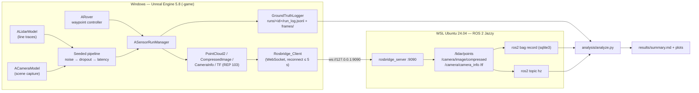

# Sensor Sim Sandbox

> This repository is **private** — no public license, no packaging, no public releases.

## Description

A drivable Unreal Engine 5.8 rover whose simulated **lidar** (raycast, 16 × 360 rays per
scan) and **camera** (scene capture, 640×480 JPEG) run through a shared, seeded sensor
pipeline (Gaussian noise → dropout → latency queue) and stream to **ROS 2 Jazzy** in WSL
over a rosbridge WebSocket (no DDS between Windows and WSL). Every capture is logged with
its ground truth to a JSONL Run_Log, and a Python tool (`analysis/analyze.py`) measures
each sensor's bias / std / RMSE, dropout, latency and publish rate against the configured
values.

## Demo


The rover follows its waypoint route in `RoverLevel` (chase camera; 10 s of the
end-to-end run, captured from the game's own viewport by `scripts/run_e2e.ps1`).

## Architecture



## Run instructions

Prerequisites (versions in [`docs/ENVIRONMENT.md`](docs/ENVIRONMENT.md)): UE 5.8 at
`C:\Program Files (x86)\UE_5.8`, WSL distro `Ubuntu` with ROS 2 Jazzy and
`ros-jazzy-rosbridge-suite`, FFmpeg on `PATH`, and the analysis venv:

```powershell
py -3.12 -m venv .venv
.\.venv\Scripts\python -m pip install -r analysis\requirements.txt
```

**End-to-end run (one command).** Checks the tracked tree is clean, starts rosbridge in
WSL if needed, builds the editor target, records a bag, launches `RoverLevel -game` in
waypoint mode with the sensor run, measures `ros2 topic hz` for 60 s, writes the demo GIF,
stops at ≥ 2,000 camera frames and ≥ 120 s, and runs the analysis:

```powershell
pwsh -NoProfile -File scripts\run_e2e.ps1
```

**Analysis only** (on the latest run, `runs/latest` → the run folder):

```powershell
.\.venv\Scripts\python analysis\analyze.py --run config/run.yaml
```

**Drive manually / view in RViz2.** Launch the game in manual mode (W/S throttle, A/D
steer) and watch the topics from WSL:

```powershell
& "C:\Program Files (x86)\UE_5.8\Engine\Binaries\Win64\UnrealEditor.exe" `
  "$PWD\unreal\SensorSimSandbox\SensorSimSandbox.uproject" /Game/Maps/RoverLevel -game -windowed -E2ERun -RoverMode=Manual
wsl -d Ubuntu -- bash -lc "source /opt/ros/jazzy/setup.bash && rviz2"   # fixed frame: odom
```

## Measured results

Copied from the generated [`results/summary.md`](results/summary.md) (never hand-edited).
Command `pwsh -NoProfile -File scripts\run_e2e.ps1`, seed **1234**, commit
**`6486781250115858cf3b39f4d61ca8bdbaa8363f`**, run `e2e_20261017_180743`
(223.8 s, 2,000 lidar scans, 2,000 camera frames of which 97 dropped, average frame time
24.053 ms).

| Sensor | Bias | Std | RMSE | Measured dropout | Configured dropout | Measured latency (ms) | Configured latency (ms) | Achieved rate (Hz) | Target rate (Hz) |
| --- | --- | --- | --- | --- | --- | --- | --- | --- | --- |
| lidar  | 0.000006 m | 0.019991 m | 0.019991 m | 0.099815 | 0.1000 | 243.538 | 200 | 8.9580 | 10 |
| camera | 1.013072 | 3.371923 | 3.520821 | 0.048549 | 0.0500 | 243.600 | 200 | 8.5229 | 10 |

Configured noise: lidar σ = 0.02 m (recovered 0.019991 m); camera σ = 5 intensity levels
(the camera error is published JPEG vs truth PNG on sampled frames, so JPEG compression
smooths part of the injected noise and adds its own error). Achieved rate is
`(n − 1) / T` over the whole run's `t_publish`.

**ROS 2 publish rates (target 10 Hz, not met):**

- `/lidar/points`: **9.775 Hz** — `ros2 topic hz /lidar/points`, 60 s window (raw output in `runs/<id>/hz/`); seed 1234, commit `6486781…`.
- `/camera/image/compressed` at 640×480: **9.420 Hz** — `ros2 topic hz /camera/image/compressed`, 60 s window; seed 1234, commit `6486781…`.

Causes, reported rather than tuned away (Requirement 0.4): the camera publishes only the
95 % of frames that survive `frame_dropout_prob = 0.05`, so its expected topic rate at a
10 Hz capture rate is 9.5 Hz; and both sensors capture on the game tick, so hitches
(scene-capture readback, demo screenshots after t = 100 s, host load) delay captures. The
same commit's earlier run on a less loaded host measured 9.997 Hz for lidar; the rates
above are the ones from the run whose summary is committed.

Latency is 243.5 ms against a configured 200 ms (+22 %): the queue is checked once per
game tick and this run averaged 24 ms per frame, outside the ±20 % / < 40 ms-tick
assumption in the design. Runs with a 13–14 ms average frame time measured 220–223 ms.

Plots: [`results/lidar_error_hist.png`](results/lidar_error_hist.png),
[`results/camera_error_hist.png`](results/camera_error_hist.png),
[`results/configured_vs_measured.png`](results/configured_vs_measured.png).

## Test commands

The exact single command for each test suite (Requirement 9.6).

**Unreal Automation tests (headless).** `scripts/run_ue_tests.ps1` builds the
editor target, then runs every project test (all registered under the
`SensorSimSandbox.` prefix) headless and exits 0 only when every test passed and
at least one ran (28 tests at the time of writing):

```powershell
pwsh -NoProfile -File scripts\run_ue_tests.ps1
```

Under the hood it runs the engine's headless automation command (the report is
written to `runs/logs/ue_tests/report/index.json` and parsed; the script exits 0
only if `failed == 0`, `succeeded >= 1`, and `notRun == 0`):

```text
UnrealEditor-Cmd.exe <uproject> -ExecCmds="Automation RunTests SensorSimSandbox;Quit" -unattended -nopause -nosplash -nullrhi -testexit="Automation Test Queue Empty" -ReportExportPath=runs/logs/ue_tests/report -log
```

Pass `-EnginePath` to point at a different UE 5.8 install (default
`C:\Program Files (x86)\UE_5.8`).

**Python analysis tests (pytest + Hypothesis).** Runs locally and in GitHub Actions:

```powershell
.\.venv\Scripts\python -m pytest analysis/tests
```

## Known limitations

- Publish rates fall short of 10 Hz (see above); captures run on the game tick, so the
  rate depends on frame time and host load.
- Latency resolution is one game tick; at a 24 ms average frame time the measured latency
  is 22 % above the configured value.
- The scene has no sky atmosphere (black sky); lighting is a directional light and a sky
  light spawned from `config/level.yaml`.
- rosbridge must be served with `url_path:=//` because UE's libwebsockets requests `GET //`.
- Unreal tests need a local UE 5.8 install and GPU; CI runs only the Python suite.
- The repository is shared with sibling projects; scripts stage and check only tracked files.

## Reproducibility & governance

- Versions of every tool/plugin/API are proven on the machine and recorded in
  [`docs/ENVIRONMENT.md`](docs/ENVIRONMENT.md).
- Third-party licenses are recorded in [`THIRD_PARTY.md`](THIRD_PARTY.md).
- No secrets are committed; secrets are read from environment variables and every
  secret-bearing file is listed in [`.gitignore`](.gitignore).
