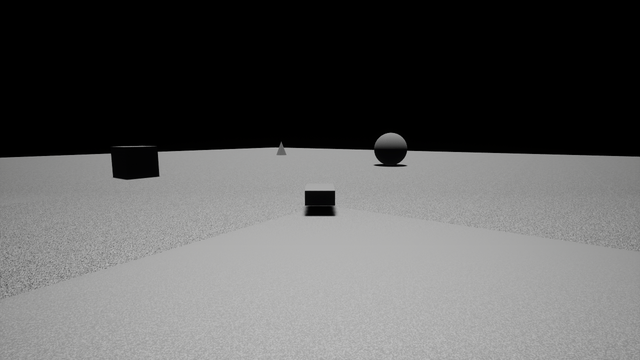
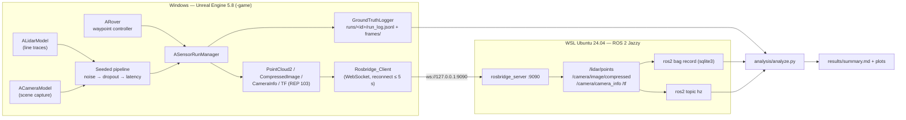

# Sensor Sim Sandbox

A drivable Unreal Engine 5.8 rover with simulated **lidar** (raycast, 16 × 360 rays per
scan), **camera** (scene capture, 640×480 JPEG), **IMU** and **GPS**. All four sensors run
through one shared, seeded pipeline (Gaussian noise → dropout → latency queue) and stream
to **ROS 2 Jazzy** over a rosbridge WebSocket. Every capture is logged next to its ground
truth, and a Python tool (`analysis/analyze.py`) measures each sensor's bias, std, RMSE,
dropout, latency and publish rate against the values it was configured with.

**Why it matters:** autonomy software tested in simulation is only as trustworthy as the
simulated sensors. This project treats the sensor models as something to verify: it
configures an error model, runs the sim, and checks from the logs that the published data
actually has that error model.

## Headline results

From one seeded end-to-end run (seed 1234, 2,000 lidar scans, 2,000 camera frames; full
table and provenance [below](#measured-results)):

- **Lidar range noise:** measured std **0.019992 m** vs **0.02 m** configured; measured
  dropout **0.099984** vs **0.10** configured; bias -0.000008 m.
- **IMU / GPS:** accelerometer bias 0.020007 vs 0.02 m/s² and std 0.050033 vs 0.05 m/s²;
  GPS bias 0.305687 vs 0.3 m and std 0.497535 vs 0.5 m.
- **Not met:** ROS 2 publish rates were **9.330 Hz** (lidar) and **8.963 Hz** (camera)
  against a 10 Hz target, and latency is one to two game ticks above its configured value.
  The causes are explained below rather than tuned away.

These are point estimates from a single run; the analysis does not compute confidence
intervals. The statistical tolerances (std within ±10 %, dropout within ±2 pp, latency
within ±20 %) are checked by seeded property tests over ≥ 100 generated cases each.



*The rover follows its waypoint route in `RoverLevel` (chase camera; 10 s of the
end-to-end run, captured from the game's own viewport by `scripts/run_e2e.ps1`).*

## What I built

- **Rover and level (UE 5.8 C++):** a drivable `ARover` pawn with a manual mode and a
  waypoint controller whose state machine is separate from rendering so it can be unit
  tested; the level is generated from `config/level.yaml` using only engine basic shapes.
- **Sensor models:** raycast lidar, scene-capture camera, and IMU/GPS derived from the rover
  pose, all bound-checked against their configs (an out-of-bound value is rejected, named,
  and the last valid config kept).
- **Shared seeded pipeline:** each sensor gets its own RNG derived from the run seed and
  its name, so a run is reproducible per sensor; the latency queue releases a sample at
  the first tick where `capture_time + latency <= now`.
- **ROS 2 bridge:** a C++ rosbridge WebSocket client (with reconnect) publishing
  `sensor_msgs/PointCloud2`, `CompressedImage`, `CameraInfo`, `Imu`, `NavSatFix` and
  `tf2_msgs/TFMessage`, with Unreal-to-ROS coordinate conversion per REP 103. No DDS
  crosses the Windows/WSL boundary.
- **Ground-truth logging and analysis:** a JSONL run log holding each published sample
  with its truth, and a Python analysis that pairs them, reads `ros2 bag` recordings with
  the pure-Python `rosbags` package, and writes `results/summary.md` and the plots.
- **Tests:** 33 Unreal Automation tests (property tests for determinism, config bounds,
  noise/dropout/latency, coordinate conversion, message well-formedness, bridge framing
  and reconnect, plus example tests) and a pytest + Hypothesis suite for the analysis,
  which CI runs on every push.

## Architecture



## Quickstart without Unreal (CPU only, a few minutes)

The analysis and its tests run on any machine with Python 3.12; no Unreal Engine, GPU or
ROS install is needed. From a fresh clone (Windows PowerShell):

```powershell
py -3.12 -m venv .venv
.\.venv\Scripts\python -m pip install -r analysis\requirements.txt
.\.venv\Scripts\python -m pytest analysis/tests -q
```

Then run the full analysis on a synthetic run log with known injected errors (lidar
σ = 0.02 m, dropout 0.10, latency 200 ms) and check that it recovers them:

```powershell
cd analysis; ..\.venv\Scripts\python -m sensorsim_analysis.synthetic ..\runs\synthetic\run_log.jsonl; cd ..
.\.venv\Scripts\python analysis\analyze.py --run config/run.yaml --log runs/synthetic/run_log.jsonl --out runs/synthetic/results
```

This writes `runs/synthetic/results/summary.md` and the error plots. On Linux or macOS use
`python3.12 -m venv .venv` and `.venv/bin/python` instead.

## Full run (needs Unreal Engine 5.8, a GPU and ROS 2)

Prerequisites (versions in [`docs/ENVIRONMENT.md`](docs/ENVIRONMENT.md)): Windows with an
NVIDIA GPU, UE 5.8 at `C:\Program Files (x86)\UE_5.8`, WSL distro `Ubuntu` with ROS 2
Jazzy and `ros-jazzy-rosbridge-suite`, FFmpeg on `PATH`, and the analysis venv above.

**End-to-end run (one command).** Checks the tracked tree is clean, starts rosbridge in
WSL if needed, builds the editor target, records a bag, launches `RoverLevel -game` in
waypoint mode with the sensor run, measures `ros2 topic hz` for 60 s, writes the demo GIF,
stops at ≥ 2,000 camera frames and ≥ 120 s, and runs the analysis:

```powershell
pwsh -NoProfile -File scripts\run_e2e.ps1
```

**Analysis only** (on the latest run, `runs/latest` → the run folder):

```powershell
.\.venv\Scripts\python analysis\analyze.py --run config/run.yaml
```

**Drive manually / view in RViz2.** Launch the game in manual mode (W/S throttle, A/D
steer) and watch the topics from WSL:

```powershell
& "C:\Program Files (x86)\UE_5.8\Engine\Binaries\Win64\UnrealEditor.exe" `
  "$PWD\unreal\SensorSimSandbox\SensorSimSandbox.uproject" /Game/Maps/RoverLevel -game -windowed -E2ERun -RoverMode=Manual
wsl -d Ubuntu -- bash -lc "source /opt/ros/jazzy/setup.bash && rviz2"   # fixed frame: odom
```

## Measured results

Copied from the generated [`results/summary.md`](results/summary.md) (never hand-edited).
Command `pwsh -NoProfile -File scripts\run_e2e.ps1 -SkipBuild`, seed **1234**, commit
**`f92afce57feadb4e9ae74804bd2850f8119701ca`**, run `e2e_20261017_182940` (210.0 s;
2,000 lidar scans; 2,000 camera frames, 97 dropped; IMU and GPS enabled; average frame
time 26.223 ms).

| Sensor | Bias | Configured bias | Std | Configured σ | RMSE | Measured dropout | Configured dropout | Measured latency (ms) | Configured latency (ms) | Achieved rate (Hz) | Target rate (Hz) |
| --- | --- | --- | --- | --- | --- | --- | --- | --- | --- | --- | --- |
| lidar (m) | -0.000008 | — | 0.019992 | 0.02 | 0.019992 | 0.099984 | 0.10 | 231.020 | 200 | 9.5698 | 10 |
| camera (intensity) | 1.013167 | — | 3.360541 | 5 | 3.509949 | 0.048573 | 0.05 | 230.786 | 200 | 9.1048 | 10 |
| imu_accel (m/s²) | 0.020007 | 0.02 | 0.050033 | 0.05 | 0.053885 | 0.019275 | 0.02 | 48.559 | 20 | 30.6763 | 50 (configured) |
| imu_gyro (rad/s) | 0.000950 | 0.001 | 0.005010 | 0.005 | 0.005099 | 0.019275 | 0.02 | 48.559 | 20 | 30.6763 | 50 (configured) |
| gps (m) | 0.305687 | 0.3 | 0.497535 | 0.5 | 0.583939 | 0.048048 | 0.05 | 126.837 | 100 | 9.1144 | 10 (configured) |

The camera error is published JPEG vs truth PNG on sampled frames, so JPEG compression
smooths part of the injected σ = 5 noise and adds its own error. Achieved rate is
`(n − 1) / T` over the whole run's `t_publish`.

**ROS 2 publish rates (target 10 Hz, not met in this run):**

- `/lidar/points`: **9.330 Hz** — `ros2 topic hz /lidar/points`, 60 s window (raw output in `runs/<id>/hz/`); seed 1234, commit `f92afce…`.
- `/camera/image/compressed` at 640×480: **8.963 Hz** — `ros2 topic hz /camera/image/compressed`, 60 s window; seed 1234, commit `f92afce…`.
- Bag cross-check over the whole run: `/lidar/points` 9.569 Hz, `/camera/image/compressed` 9.104 Hz, `/imu` 30.698 Hz, `/gps/fix` 9.113 Hz.

Causes, reported rather than tuned away:
- **Dropout:** the camera and GPS publish only the samples that survive their dropout (5 %), so at a 10 Hz capture rate their expected topic rate is 9.5 Hz.
- **Game-tick capture:** every sensor captures and releases on the game tick, at most once per tick. Frame-time hitches (scene-capture readback, demo screenshots after t = 100 s, host load) therefore delay captures. This run averaged 26 ms per frame, so the IMU (configured 50 Hz) got about 31 Hz.
- **Host load:** the same code measured higher on a less loaded host. Commit `aa625bf` (13 ms average frame time) got lidar 9.997 Hz / camera 9.640 Hz; commit `724ce26` (18 ms) got lidar 10.044 Hz / camera 9.669 Hz. See [`docs/evidence/gate_a.md`](docs/evidence/gate_a.md) and [`docs/evidence/m5.md`](docs/evidence/m5.md).

Latency runs 15–30 ms (one to two game ticks) above the configured value. The queue is checked once per tick, so the release error lies in `[0, dt)`; at a 26 ms average tick the lidar and camera are 15 % over their 200 ms target, inside ±20 %. The IMU (20 ms target) and GPS (100 ms) are well outside ±20 % because one tick is a large fraction of their latency.

Plots: [`results/lidar_error_hist.png`](results/lidar_error_hist.png),
[`results/camera_error_hist.png`](results/camera_error_hist.png),
[`results/imu_accel_error_hist.png`](results/imu_accel_error_hist.png),
[`results/imu_gyro_error_hist.png`](results/imu_gyro_error_hist.png),
[`results/gps_error_hist.png`](results/gps_error_hist.png),
[`results/configured_vs_measured.png`](results/configured_vs_measured.png).

## Test commands

**Python analysis tests (pytest + Hypothesis).** Run locally and in GitHub Actions on
every push and pull request:

```powershell
.\.venv\Scripts\python -m pytest analysis/tests
```

**Unreal Automation tests (headless, needs a local UE 5.8 install).**
`scripts/run_ue_tests.ps1` builds the editor target, then runs every project test (all
registered under the `SensorSimSandbox.` prefix) headless and exits 0 only when every
test passed and at least one ran (33 tests at the time of writing):

```powershell
pwsh -NoProfile -File scripts\run_ue_tests.ps1
```

Under the hood it runs the engine's headless automation command (the report is
written to `runs/logs/ue_tests/report/index.json` and parsed; the script exits 0
only if `failed == 0`, `succeeded >= 1`, and `notRun == 0`):

```text
UnrealEditor-Cmd.exe <uproject> -ExecCmds="Automation RunTests SensorSimSandbox;Quit" -unattended -nopause -nosplash -nullrhi -testexit="Automation Test Queue Empty" -ReportExportPath=runs/logs/ue_tests/report -log
```

Pass `-EnginePath` to point at a different UE 5.8 install (default
`C:\Program Files (x86)\UE_5.8`).

## Repository layout

| Path | Contents |
| --- | --- |
| `unreal/SensorSimSandbox/` | UE 5.8 C++ project: `Rover/`, `Sensors/`, `Pipeline/`, `Bridge/`, `Coords/`, `GroundTruth/`, `Run/`, `Tests/` |
| `analysis/` | `analyze.py` entry point, `sensorsim_analysis/` package, pytest + Hypothesis tests |
| `config/` | Sensor, level, bridge and run configs (YAML) |
| `scripts/` | PowerShell run, test and smoke scripts; level builder |
| `results/` | Generated `summary.md` and plots from the reported run |
| `docs/` | Environment versions, blocker log, run evidence, demo GIF |
| `.kiro/specs/sensor-sim-sandbox/` | Requirements, design and task list the project was built from |

## Known limitations

- Publish rates fall short of 10 Hz (see above); captures run on the game tick, so the
  rate depends on frame time and host load.
- Latency resolution is one game tick, so short configured latencies (IMU 20 ms, GPS
  100 ms) come out well above target, outside ±20 %.
- The IMU truth comes from finite differences of the rover pose per tick. GPS uses a
  spherical local-tangent-plane conversion about `config/gps.yaml`'s origin, with odom
  x = east and y = north.
- The scene has no sky atmosphere (black sky); lighting is a directional light and a sky
  light spawned from `config/level.yaml`.
- rosbridge must be served with `url_path:=//` because UE's libwebsockets requests `GET //`.
- The simulation runs only on Windows with UE 5.8 and a GPU, and was built and measured on
  one machine (RTX 3080). CI runs only the Python suite; the Unreal tests and the
  end-to-end run are run locally.
- Raw run logs and bags live under `runs/` and are not committed; only the generated
  summary and plots are.

## Reproducibility

- Versions of every tool, plugin and API are proven on the machine and recorded in
  [`docs/ENVIRONMENT.md`](docs/ENVIRONMENT.md); Python dependencies are pinned in
  [`analysis/requirements.txt`](analysis/requirements.txt).
- Seeds are fixed, and every reported number records the command, seed and commit that
  produced it.
- No secrets are committed; secrets are read from environment variables and every
  secret-bearing file is listed in [`.gitignore`](.gitignore).

## How this was built

This project was built with Claude Code (Anthropic's agentic coding tool) under a spec-driven workflow: written requirements, then a design, then a task list organized into milestones (the spec files under `.kiro/specs/`), each milestone ending in an automated gate script that had to pass before the next one started. The commit history shows this openly; commits carry a `Co-Authored-By` trailer naming the model that helped write them. Every reported number comes from a script in this repository and records the command, seed and commit that produced it, so nothing was typed, estimated or borrowed. I set the goals and constraints in the specification, I am accountable for the verification and the results, and I can explain and change any part of this code.

## License

Code is released under the [MIT License](LICENSE). Third-party packages are listed with
their licenses in [THIRD_PARTY.md](THIRD_PARTY.md); Unreal Engine and its content are not
redistributed. There is no packaging or release.
